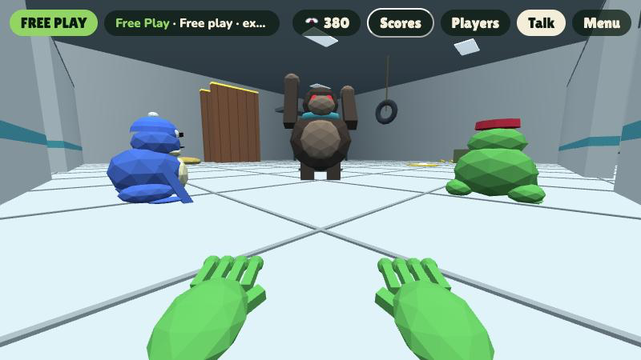
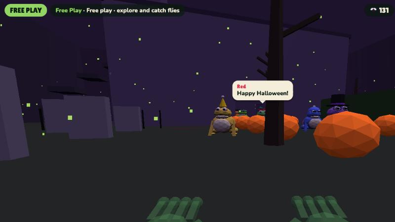

# Ribbit Tag

A 3D tag game for the browser where you play as a frog with sticky hands and no hopping allowed. You get around by pushing off the ground, walls and trees with your hands, flinging yourself across the map, and staying away from the lava frog.

**Play it:** https://josephdadams.github.io/ribbit-tag/

It runs on tablets (including Amazon Fire tablets), phones, and computers. There is nothing to install.


## Screenshots

| | |
| --- | --- |
|  |  |
| **Menu** | **Capture the Lily Pad** |
|  |  |
| **Candy Land** | **Moon Base** |
|  |  |
| **Spooky Woods** | **Wardrobe** |

## How to play

### Touch

- Each thumb is a frog hand. The left side of the screen is your left hand, the right side is your right.
- **Swipe down** to shove the ground away and launch forward. Faster swipes make bigger leaps.
- **Swipe sideways** to turn.
- Next to a tree or wall, keep swiping down to **climb** it.
- **Hold your finger down** while touching a wall, tree or ceiling to **hang on**. Swipe down to climb higher, and let go to drop.
- Your hands go see-through when there is nothing close enough to grab.
- **Tap a frog** (or press **Talk**) to chat with it.
- Grab a **gadget box** to get a gadget, then tap the yellow gadget button to use it (see Gadgets below).
- The chip at the top always starts with the game mode's name. **Tap it** for a reminder of the rules and the map.

### Controller

Plug in or pair a gamepad (Xbox, PlayStation, Switch Pro, or most Bluetooth controllers) and press any button.

| Button | Action |
| --- | --- |
| Left stick | Push: up for forward, down for back, sideways to push sideways |
| Right stick | Turn |
| Right stick click | With Look around on, look straight ahead again |
| `A` | Jump |
| `RB` / `R1` (hold) | Grab a wall, tree or ceiling and hang on |
| `RT` / `R2` (hold) | Big pushes |
| `LT` / `L2` | Use your gadget (hold for the jet pack and tongues) |
| `X` | Talk (then the D-pad sends quick replies, `RB` picks the next frog) |
| `Y` | Player list |
| `B` | Close a panel |
| `Back` / `Select` | Become the host |
| `Start` | Menu |

On menus, the D-pad or left stick moves between buttons, `A` picks, and `B` goes back. Controllers that support rumble buzz when you get tagged, frozen, bumped, or bounce.

Controllers with only one stick work too: until you move a right stick, pushing the left stick sideways turns you.

#### Magicsee R1 finger ring

Pair the ring with the tablet, then every time you turn it on, hold `@` and press `B` to put it in game mode. (Music mode, the one it starts in, only sends volume and song keys, which the tablet keeps for itself. Key mode, `@` + `C`, moves you around but its buttons land in different places.)

| Button | Action |
| --- | --- |
| Stick | Push: up for forward, down for back, sideways to turn |
| Trigger | Jump (honk in a toadhog) |
| Top button (hold) | Grab and hang on |
| `B` | Jump, or get in and out of a toadhog when you're next to one |
| `D` | Throw, or close a panel |
| `C` | Use your gadget |
| `A` (hold) | Big pushes |

On menus the stick moves between buttons and the trigger or `B` picks.

### Gadgets

Colored boxes float around every map (except in Toadhog Race, which has its own items). Touch one to pick up its gadget:

- 💦 **Bubble Bazooka**: blows big bubbles where you look. They pop with a splash that sends frogs flying. Pop one at your feet to bubble jump.
- ✨ **Firefly Jet Pack**: jars of fireflies on your back. Hold the button and they lift you up and forward until they get tired.
- 👅 **Tongue Shooters**: Spider-Man style wrist shooters that fire sticky frog tongues. Hold the button to stick to a wall and swing toward it, or hit a frog to leave it tongue-tied for a moment.

Computer frogs grab and use gadgets too. The host can turn **Gadgets** off in the menu settings.

### Look around

Turn on **Look around** in the menu settings and the tablet becomes your frog's head: point it left, right, up or down to look that way, and pushes go where you're looking. Keep moving with the controller or swipes. Tablets without a gyroscope (like most Fire tablets) can only feel tilting, so tilt up and down to look and lean the tablet like a steering wheel to turn.

### Hand camera

Set **Hand camera** to **Hands** in the menu settings and the camera watches your real hands. Pick **Front** or **Back** under **Which camera**, then point that camera so it can see both hands. Each hand works like a thumb on that side of the screen:

- **Push your hand down** to shove off and launch forward. Faster pushes make bigger leaps.
- **Move your hand sideways** to turn.
- **Make a fist** next to a wall, tree or ceiling to hang on. Open your hand to let go.

A camera picture shows what it sees, with dots on each hand (yellow means a fist). **Camera size** makes it Small or Big in the corner, or Half to fill the whole left side of the screen. The hand tracker ([MediaPipe](https://ai.google.dev/edge/mediapipe/solutions/vision/hand_landmarker)) runs on the tablet itself, so the camera picture never leaves the device. It needs the internet the first time to download the tracker.

#### Wands

Set **Hand camera** to **Wands** to track two bright colors instead of bare hands. It's much lighter than the hand tracker, so it keeps up better on slow tablets like the Fire, and fast swings still count. Make a wand for each hand with something brightly colored on the end: a painted ping-pong ball or a circle of craft foam works well. The game starts out looking for **neon green on the left** and **hot pink on the right**.

- **Push a wand down** to shove off, **move it sideways** to turn, just like hands.
- **Pull a wand close to the camera** next to a wall, tree or ceiling to hang on. Move it back out to let go.
- Using other colors? Tap **Set colors**, hold each wand in its circle on the camera picture, and wait for the countdown. **Green + pink** puts the starting colors back.

Pick two colors that look very different from each other, and from your clothes and the room behind you. Good light helps a lot.

### Keyboard

| Key | Action |
| --- | --- |
| `W` / `↑` | Push forward (hold to keep going) |
| `S` / `↓` | Push backward |
| `A` `D` / `←` `→` | Turn |
| `Q` `E` | Push sideways |
| `Space` | Jump (climbs higher next to a wall) |
| `C` (hold) | Grab a wall, tree or ceiling and hang on |
| `Shift` (hold) | Big pushes |
| `R` | Use your gadget (hold for the jet pack and tongues) |
| `T` or `Enter` | Talk |
| `1`–`9` | Quick replies while talking |
| `Tab` | Talk to the next frog |
| `P` | Player list |
| `L` | Scores |
| `I` | What mode is this? (rules and map) |
| `H` | Become the host |
| `M` | Music on/off |
| `G` | Get in or out of a Toadhog |
| `Esc` | Close a panel, or go back to the menu |

On the menu: `1` Infection, `2` Classic Tag, `3` Capture the Lily Pad, `4` Freeze Tag, `5` Hot Potato, `6` Fly Feast, `7` Free Play, `8` King of the Lily Pad, `Q` Daily quests, `O` Play online, `R` Wardrobe, `F` Meet the frogs.

## Game modes

- **Infection**: every tag makes another lava frog. Be the last frog standing.
- **Classic Tag**: one lava frog. Get tagged and you're it.
- **Capture the Lily Pad**: Green team versus Blue team. Grab the other team's lotus flower, carry it back, and touch your own lily pad while your lotus is safe at home. Intruders tagged on the other team's half go back to their base and drop the lotus. First to 3 captures wins.
- **Freeze Tag**: tagged frogs freeze into ice. Touch a frozen friend to free them. The taggers win if everyone is frozen; the runners win if anyone is still free after 2 minutes.
- **Hot Potato**: one frog holds a buzzing hot fly that beeps faster and faster. Tag someone to pass it. When it pops, whoever holds it is out. Last frog standing wins.
- **Fly Feast**: catch the most flies in 90 seconds. Everyone in a room sees the same flies.
- **King of the Lily Pad**: stand on the golden lily pad alone to score a point every second, and bump other frogs off it. The pad moves every 35 seconds. First to 60 wins.
- **Free Play**: no tagging. Explore, climb, bounce, talk to the frogs, and catch flies.

- **Monster Night** (in More modes, under Spooky): everyone teams up against monsters that hunt you down. Pumpkin Heads are fast, Swamp Blobs climb walls, and Ghosts float through walls. Throw fireflies (`F`, a quick tap, or `B`) to stun them, touch caught friends to free them, and survive 3 minutes. Spookiest on Haunted Manor.
- **Lethal Toad** (in More modes, under Spooky, inspired by Lethal Ape): your ship lands and the team has 4 minutes to grab scrap (rubber ducks, golden cups, cash registers and more) and carry it back to the ship to make the quota. Three monsters hunt you: **Ashy** (made of grey gravel, the calm one who gives up quickly), **Sandman** (his sandy brother: faster, grumpier, and he leaves piles of sand that slow you down), and **Gus** (blind, but he hears anything that moves fast, even through walls, so freeze or sneak when he's close). Get caught and you drop your scrap and go back to the ship. Monsters never come near the ship's lights. Heavy scrap slows you down, and the Air Horn honks, so Gus can hear whoever is carrying it. Some computer frogs stay on the ship as lookouts. Best on The Laboratory or The Backrooms.
- **Blood A** (in More modes, under Spooky, Asher's idea): night falls and **Blood Asher** haunts the woods, a see-through ghost with curly hair, his ribs showing, and an old red telephone in his hand. He floats around looking for frogs, and if he sees you he chases you, so break his line of sight behind trees and walls until he gives up. Nobody has a name tag, so in the dark you can't tell a friend from him. Every so often he screams into his telephone, and you hear it crackle out of the loudspeakers on the telephone poles out in the forest (closer speakers are louder, and you can hear which side they're on). Touch caught friends to free them and survive 3 minutes.

Tap **More modes** on the menu for even more:

| Tag twists | Team games | Races and challenges | Party |
| --- | --- | --- | --- |
| **Hide and Seek**: seekers count to 20, found frogs help seek | **Mud Splat**: throw mud, three splats sends a frog home | **Hop Race**: through 8 glowing rings in order | **Musical Lily Pads**: when the music stops, find a pad |
| **Bat Tag**: lights out, the lava frog glows | **Lily Pad Soccer**: push the ball onto their lily pad | **Floor Is Lava**: the lava rises, climb high | **Sardines**: find the hider, then hide with them |
| **Shrink Tag**: each tag shrinks you, last big frog wins | **Pond Ball**: dodgeball, hit frogs sit out | **Bug Swarm**: everyone squashes bugs to save the lily pad | **Slap Battle**: slap frogs off a giant floating lily pad |
| **Sticky Tongue Tag**: the lava frog tags from afar | | **Simon Says Frog**: only obey "Silver says" | |
| **Keep Away**: hold the golden crown the longest | | **Toadhog Race**: the map turns into a race track, first to 3 laps wins | |
| **Gravity Swap**: gravity changes every 20 seconds | | | |

In Toadhog Race every map has its own track: a figure 8 with a bridge, clovers full of hairpins, a wavy flower or a big loop, with hills to catch air off and tunnels. The hazards fit the map: ice, oil and slime spin you out, mud and chocolate slow you down, lava pops you up, boost pads shoot you forward, and blocks slide across the road. Every frog starts in a toadhog on the grid. Drive through the rainbow ? boxes for an item, then press `F` (or `B` on a controller, or the item button) to use it: 🔥 Turbo, 🐢 Turtle Shell (fires ahead and bounces off walls), 🍌 Banana Peel (drops behind you) or ⭐ Golden Fly (fast, and nothing can stop you). Frogs near the back get the better items. Hit a hill fast enough and your toadhog takes off. Bump other hogs to knock them off their line: hit one from behind to shove it forward, or hit its side to slide it over and spin it. Drop out with `G` and you can climb back in.

In Mud Splat and Pond Ball, throw with `F`, a quick tap on the screen, or `B` on a controller.

**Slap Battle** (inspired by the slap games on Roblox, and Abraham's idea): everyone starts on a giant lily pad floating high over the map. Slap with `F`, a quick tap, the **Slap** button, `B` on a controller, `D` on the Magicsee R1 ring, or by making a fist with Hand camera. Each slap knocks a frog back; knock one off the edge within a few seconds of slapping it and you score. Frogs who fall pop back onto the pad a moment later. First to 15, or the most after 2½ minutes, wins. Glove boxes appear on the pad; grab one to swap gloves:

| Glove | Power |
| --- | --- |
| 🧤 Lily Glove | Everyone starts with it. A good all-round slap |
| 🥊 Big Bonk | Slow, but sends frogs flying |
| ⚡ Zippy Glove | Super quick little slaps, and you zoom forward |
| 🎈 Boing Glove | Pops frogs way up high |
| 🧊 Slippy Glove | Slapped frogs slide like they're on ice |

## Daily quests

Every day brings three new quests, like "Catch 25 flies", "Unfreeze 4 frogs in Freeze Tag", or "Be king of the lily pad for 40 seconds". Finish one and claim its fly reward from **Daily quests** on the menu. New quests arrive at midnight.

## Scores and records

Tap **Scores** during a game (or press `L`) to see everyone in the game ranked by the mode's score, or by tags in modes that don't keep one. The menu shows your personal records: your longest Infection survival, the most tags you've made in one game, and your total tags.

## Maps

Forest, Mega Map, Frog Gulch, Crystal Caves, Canyon, Beach, Snowy Peaks, Volcano, Sky Islands, Moon Base, Candy Land, Spooky Woods, City Rooftops, Lily Pond, Misty Swamp, Giant Garden, Rainforest Canopy, Pirate Cove, Coral Reef, Toy Room, Ice Castle, The Stump (a giant hollow tree stump to hang out in, with jump walls), The Backrooms (a yellow maze under humming lights), and The Laboratory (a secret lab with monsters loose).

- **Mega Map**: one giant world. Forest in the middle, a city to the east, snowy peaks to the north, and caves underneath. Tunnels, a subway, a log bridge and a skybridge join it all up, and a ramp lets you drive down into the caves.
- **The Stump** and several other maps have **jump walls**: two tall plank walls close together. Push off one, then the other, to climb fast.
- **Frog Gulch**: a long grassy canyon with a base at each end (great for Capture the Lily Pad), rolling hills, a rock arch and teleporters up to the cliff perches.

### The Laboratory



A secret lab with four monsters on the loose, each in its own room:

- **The Big Ape** in the Ape Enclosure: fast, but it can't climb, so get up high.
- **The Goo Blob** in the Goo Lab: slow, but it climbs walls.
- **The Statue Bot** in the Robot Workshop: it only moves when nobody is looking at it. Don't look away!
- **The Zapper Drone** in the Server Room: it flies over the server racks with a searchlight.

The monsters go about their business until they see you. Then the alarm lights flash and they chase you. Get out of sight and stay hidden, and after a few seconds they give up and go back to what they were doing (you get a fly for it). If one catches you, you go back to the green **Safe Room**, where monsters never go. They chase computer frogs too.

The lab is full of hazards: **flash plates** that blind you for a few seconds (and dazzle nearby monsters), **laser fences** that switch on and off and zap you back, **air vents** that blast you up to the tops of the walls, slippery slime, sticky sludge, a conveyor belt, and a **broken teleporter** that sends you somewhere random. The monsters are part of the map, so they show up in every game mode.

### Toadhogs

The Mega Map and Frog Gulch have **Toadhogs**: jeeps with frog eyes. Walk up to one and tap **Drive** (or press `G`, or `LB` on a controller). Three frogs fit: a driver, a passenger and one standing in the back.

- Keyboard: `W`/`S` to drive, `A`/`D` to steer, `Space` to honk.
- Touch: put a finger down and drag up to drive, down to reverse, sideways to steer.
- Controller: left stick, or `RT`/`LT` for gas and reverse. `A` honks.

Each Toadhog has its own engine that revs as it speeds up. A speeding Toadhog bumps frogs out of the way, and a lava frog driving one tags anyone it hits. Empty hogs drive themselves home after a while.

### Holiday maps

<!-- HOLIDAY-MAP:START -->
### Now on the menu: Haunted Manor

The Halloween map is available until Nov 2. Look for it under **Limited time** on the map picker.


<!-- HOLIDAY-MAP:END -->

Some maps only show up on the menu (under **Limited time**) around a holiday:

| Map | Holiday | Available |
| --- | --- | --- |
| Haunted Manor | Halloween | Oct 1 – Nov 2 |
| Harvest Farm | Thanksgiving | Nov 10 – Nov 30 |
| Santa's Village | Christmas and New Year | Dec 1 – Jan 6 |
| Sweetheart Garden | Valentine's Day | Feb 7 – Feb 15 |
| Rainbow Hills | St. Patrick's Day | Mar 10 – Mar 18 |
| Egg Hunt Meadow | Easter and spring | Mar 25 – Apr 20 |
| Fireworks Lake | Fourth of July | Jun 28 – Jul 6 |

To preview one early, add `?season=MM-DD` to the address, for example `?season=12-15` for Santa's Village. If a room's host picks a holiday map, everyone in the room can play it.

Some maps change how you move: lily pads on Lily Pond and Misty Swamp and the bed in the Toy Room are bouncy, Coral Reef is underwater with low gravity and drag, ice on Snowy Peaks and in the Ice Castle is slippery, water, mud and the chocolate river in Candy Land slow you down, and Moon Base has low gravity. Each map has its own music.

## The computer frogs

Up to nine computer frogs play with you, each with a name, a voice, and a personality: Red (the show-off), Blue (super chill), Yellow (hyper), Purple (the smart one, with real frog facts), Teal (shy), Captain Orange (a pirate), Princess Pink, Coach Green, and Grandpa Silver.

They talk during the game and you can talk back with quick replies or by typing. Ask for a joke or a fact, tell one to follow you or stay put, or tease them. All dialogue is scripted and runs on the device; nothing is sent to an AI service. Voices use the device's built-in text-to-speech, and voice input appears only on browsers that offer it.

### Mystery frogs

Every few minutes a rare visitor shows up that only you can see. Each one unlocks a secret Wardrobe item:

- **LUMI88**: a pale ghost frog who hums "Twinkle, Twinkle, Little Star" and drifts closer. Get near her and she vanishes. Unlocks the Moonflower hat.
- **The Shadow Croaker**: a pitch-black frog with glowing eyes that stands perfectly still far away in dark places. Stare back at it and it blinks out. Unlocks Glowing eyes.
- **ERR0R**: a glitching frog that teleports around with a scrambled name. Catch it and it crashes, dropping flies. Unlocks the Glitch skin.
- **The Golden Frog**: a lucky frog that hops away fast. Catch it for 25 flies and the Lucky clover hat.

Some room codes are haunted: each mystery frog has three secret codes where it shows up much more often. Listen for clues when they vanish.

Mystery frogs show up in the Players list as "???" while they're around. They can be turned off on the menu.

## Wardrobe

Catch flies around each map, stay safe, tag other frogs, and win games to earn flies. Spend them in the Wardrobe on hats (including a pet fly that circles your head), face items, back items (capes, wings, a balloon, a jetpack), and skins, from plain colors to patterned poison dart, bumblebee and tiger frogs and a color-shifting rainbow frog. Progress is saved in the browser on each device.

## Multiplayer

- **Friends room:** the host types a room code (or taps **New code**), picks a map, and taps a game mode to start their game. Everyone else types the same code and taps **Join** to play in the host's game. Guests never take over or start a separate game; if the host leaves, they wait for them to come back.
- **Frogs online:** the menu shows how many people are playing Ribbit Tag right now and roughly where (public games, friends rooms, solo, or on the menu). Room codes are only ever shared with friends.
- **Friends:** every device gets its own friend code (like `KP7-QX2`), shown under **Add a friend** on the menu. When one of you types the other's code, you both get added (the next time you're online at the same time), and the Friends list shows who's online, where they are, and a **Join** button when they're in a friends room or public game. Your name and room only go out locked with your friend code, so only frogs who have your code can see them. Friends' notes travel both directly between devices and through a few free public MQTT servers, so friends still show up on browsers that block direct connections (like Brave, or iPhones on some networks). Friends are saved on each device, and removing someone keeps them from adding themselves back.
- **Play online:** joins a public lobby with anyone else playing (up to 6 people per lobby).

Players connect directly to each other with WebRTC through [Trystero](https://github.com/dmotz/trystero), using free public servers only to find each other. Friends rooms search three ways at once (Nostr relays, BitTorrent trackers, and MQTT brokers) and connect over whichever finds the other device first, and a guest who can't find the host keeps reconnecting until they do. When two players can't connect to each other directly (Firefox and an iPhone on the same Wi-Fi, for example), another player who's connected to both passes their messages along, so everyone still sees everyone. There is no game server. The host's device runs the computer frogs, tags, and scoring. In public lobbies there's no fixed host: if the host leaves or its device sleeps, another player takes over, and anyone can tap **Be host**.

Kid safety: players cannot send each other messages, and in public lobbies everyone's typed name is replaced with a random one like "Frog 4821".

Some networks (school Wi-Fi, some phone data plans) block direct connections. Being on the same Wi-Fi works best. The **Players** list shows connection status and troubleshooting tips, and the **Online check** at the bottom of the Friends panel shows how many servers and frogs this device can reach and whether friend codes work in this browser.

## Settings

The menu settings cover frog speed (Easy, Normal or Hard), how many computer frogs play (3, 6 or 9), your name, music, mystery frogs, frog voices, Look around, and graphics (**Auto**, **Nice** for sun shadows and smooth edges, or **Fast** for older tablets). Settings are saved on each device.

## Running it locally

The whole game is one file, `index.html`. Serve the folder with any static web server, for example:

```bash
python3 -m http.server 8000
```

Then open http://localhost:8000. Multiplayer needs the page served over `http://localhost` or HTTPS.

Add `?mystery=lumi` (or `shadow`, `glitch`, `golden`) to the URL to meet a mystery frog a few seconds into a game.

## Deploying

Pushing to `main` deploys the game automatically. The [Deploy to GitHub Pages](.github/workflows/pages.yml) workflow copies the site files, stamps the commit into `APP_VERSION`, and publishes to GitHub Pages, usually within a minute. You can also run it by hand from the **Actions** tab.

Because every deploy gets a new version stamp, players who already have the game open see a "new version" banner, and players on different versions get a warning in multiplayer. Change the base `APP_VERSION` in `index.html` only when you want a new release name.

## Built with

- [three.js](https://threejs.org/) r128 for the 3D graphics
- [Trystero](https://github.com/dmotz/trystero) 0.25.4 for peer-to-peer multiplayer
- The Web Audio API for sound effects and generated music
- The Web Speech API for the frogs' voices
- [Lilita One](https://fonts.google.com/specimen/Lilita+One) and [Nunito](https://fonts.google.com/specimen/Nunito) from Google Fonts

All music is generated by the game. LUMI88 hums "Twinkle, Twinkle, Little Star", a traditional melody in the public domain.

## Support Ribbit Tag

Ribbit Tag is free, with no ads and nothing to buy. If your family enjoys it, a grown-up can chip in on [Ko-fi](https://ko-fi.com/josephdadams) to help us keep making new maps and modes. There's a link at the bottom of the menu settings too.

## License

[MIT](LICENSE). The libraries and fonts listed above keep their own licenses.

Made by Asher and family.
