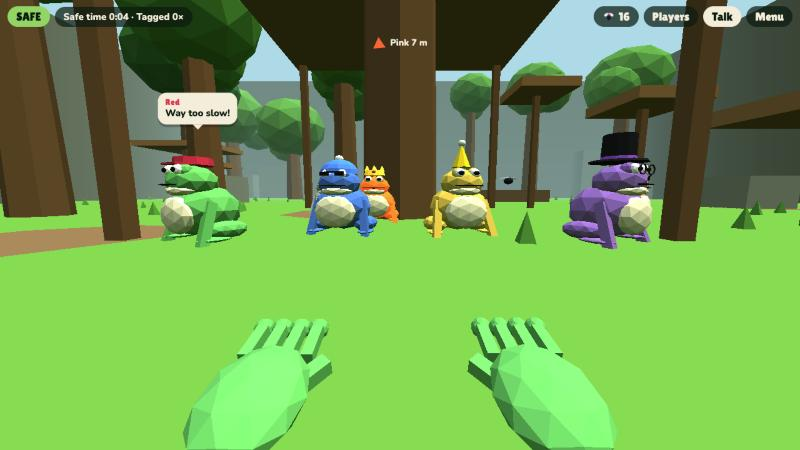
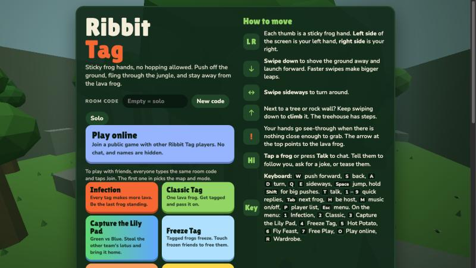
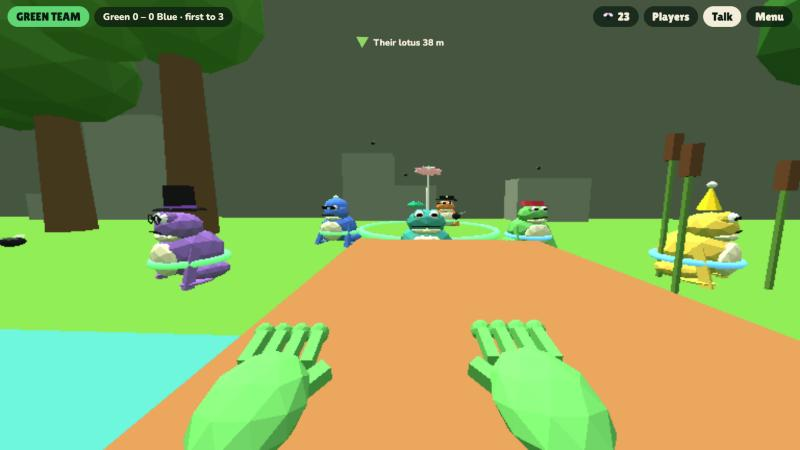
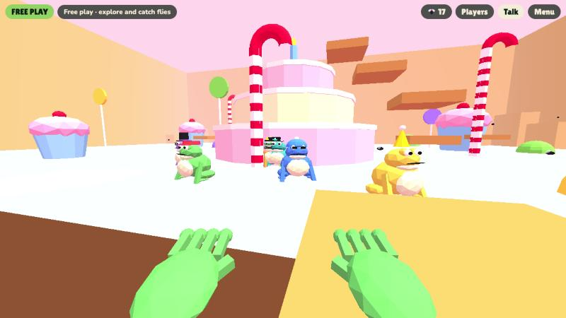
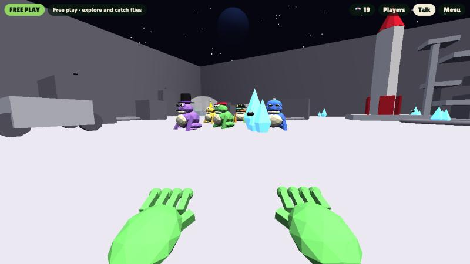
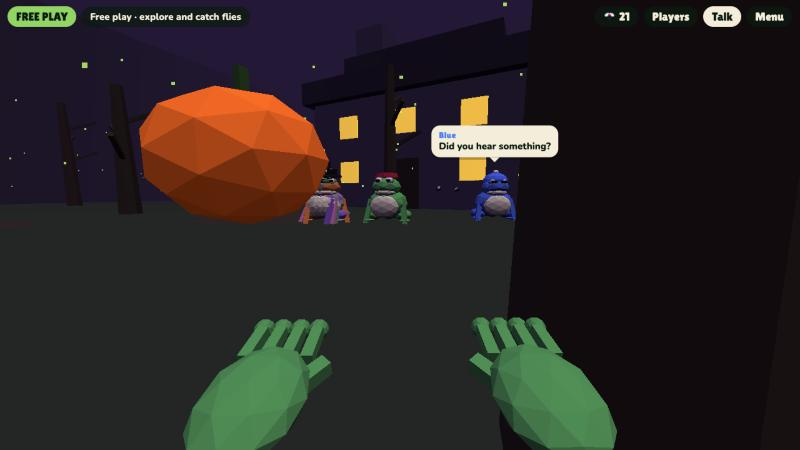
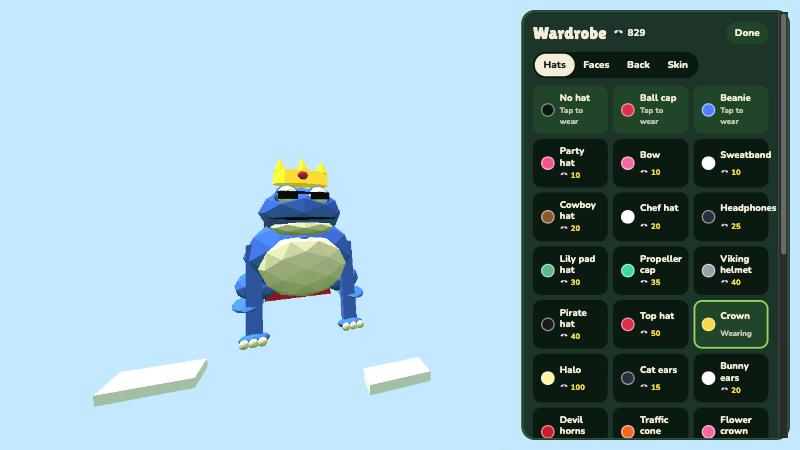

# Ribbit Tag

A 3D tag game for the browser where you play as a frog with sticky hands and no hopping allowed. You get around by pushing off the ground, walls and trees with your hands, flinging yourself across the map, and staying away from the lava frog.

**Play it:** https://josephdadams.github.io/ribbit-tag/

It runs on tablets (including Amazon Fire tablets), phones, and computers. There is nothing to install.



## Screenshots

| | |
| --- | --- |
|  |  |
| **Menu** | **Capture the Lily Pad** |
|  |  |
| **Candy Land** | **Moon Base** |
|  |  |
| **Spooky Woods** | **Wardrobe** |

## How to play

### Touch

- Each thumb is a frog hand. The left side of the screen is your left hand, the right side is your right.
- **Swipe down** to shove the ground away and launch forward. Faster swipes make bigger leaps.
- **Swipe sideways** to turn.
- Next to a tree or wall, keep swiping down to **climb** it.
- Your hands go see-through when there is nothing close enough to grab.
- **Tap a frog** (or press **Talk**) to chat with it.

### Keyboard

| Key | Action |
| --- | --- |
| `W` / `↑` | Push forward (hold to keep going) |
| `S` / `↓` | Push backward |
| `A` `D` / `←` `→` | Turn |
| `Q` `E` | Push sideways |
| `Space` | Jump (climbs higher next to a wall) |
| `Shift` (hold) | Big pushes |
| `T` or `Enter` | Talk |
| `1`–`9` | Quick replies while talking |
| `Tab` | Talk to the next frog |
| `P` | Player list |
| `H` | Become the host |
| `M` | Music on/off |
| `Esc` | Close a panel, or go back to the menu |

On the menu: `1` Infection, `2` Classic Tag, `3` Capture the Lily Pad, `4` Freeze Tag, `5` Hot Potato, `6` Fly Feast, `7` Free Play, `O` Play online, `R` Wardrobe.

## Game modes

- **Infection**: every tag makes another lava frog. Be the last frog standing.
- **Classic Tag**: one lava frog. Get tagged and you're it.
- **Capture the Lily Pad**: Green team versus Blue team. Grab the other team's lotus flower, carry it back, and touch your own lily pad while your lotus is safe at home. Intruders tagged on the other team's half go back to their base and drop the lotus. First to 3 captures wins.
- **Freeze Tag**: tagged frogs freeze into ice. Touch a frozen friend to free them. The taggers win if everyone is frozen; the runners win if anyone is still free after 2 minutes.
- **Hot Potato**: one frog holds a buzzing hot fly that beeps faster and faster. Tag someone to pass it. When it pops, whoever holds it is out. Last frog standing wins.
- **Fly Feast**: catch the most flies in 90 seconds. Everyone in a room sees the same flies.
- **Free Play**: no tagging. Explore, climb, bounce, talk to the frogs, and catch flies.

## Maps

Forest, Crystal Caves, Canyon, Beach, Snowy Peaks, Volcano, Sky Islands, Moon Base, Candy Land, Spooky Woods, City Rooftops, Lily Pond, Misty Swamp, Giant Garden, and Rainforest Canopy.

Some maps change how you move: lily pads on Lily Pond and Misty Swamp are bouncy, ice on Snowy Peaks is slippery, water, mud and the chocolate river in Candy Land slow you down, and Moon Base has low gravity. Each map has its own music.

## The computer frogs

Up to nine computer frogs play with you, each with a name, a voice, and a personality: Red (the show-off), Blue (super chill), Yellow (hyper), Purple (the smart one, with real frog facts), Teal (shy), Captain Orange (a pirate), Princess Pink, Coach Green, and Grandpa Silver.

They talk during the game and you can talk back with quick replies or by typing. Ask for a joke or a fact, tell one to follow you or stay put, or tease them. All dialogue is scripted and runs on the device; nothing is sent to an AI service. Voices use the device's built-in text-to-speech, and voice input appears only on browsers that offer it.

### Mystery frogs

Every few minutes a rare visitor shows up that only you can see. Each one unlocks a secret Wardrobe item:

- **LUMI88**: a pale ghost frog who hums "Twinkle, Twinkle, Little Star" and drifts closer. Get near her and she vanishes. Unlocks the Moonflower hat.
- **The Shadow Croaker**: a pitch-black frog with glowing eyes that stands perfectly still far away in dark places. Stare back at it and it blinks out. Unlocks Glowing eyes.
- **ERR0R**: a glitching frog that teleports around with a scrambled name. Catch it and it crashes, dropping flies. Unlocks the Glitch skin.
- **The Golden Frog**: a lucky frog that hops away fast. Catch it for 25 flies and the Lucky clover hat.

Mystery frogs show up in the Players list as "???" while they're around. They can be turned off on the menu.

## Wardrobe

Catch flies around each map, stay safe, tag other frogs, and win games to earn flies. Spend them in the Wardrobe on hats (including a pet fly that circles your head), face items, back items (capes, wings, a balloon, a jetpack), and skins, from plain colors to patterned poison dart, bumblebee and tiger frogs and a color-shifting rainbow frog. Progress is saved in the browser on each device.

## Multiplayer

- **Friends room:** everyone types the same room code on the menu and taps **Join**. The first player in picks the map and mode.
- **Play online:** joins a public lobby with anyone else playing (up to 6 people per lobby).

Players connect directly to each other with WebRTC through [Trystero](https://github.com/dmotz/trystero), using public Nostr relays only to find each other. There is no game server. One device acts as the host and runs the computer frogs, tags, and scoring; if it leaves or falls asleep, another player takes over, and anyone can tap **Be host**.

Kid safety: players cannot send each other messages, and in public lobbies everyone's typed name is replaced with a random one like "Frog 4821".

Some networks (school Wi-Fi, some phone data plans) block direct connections. Being on the same Wi-Fi works best. The **Players** list shows connection status and troubleshooting tips.

## Running it locally

The whole game is one file, `index.html`. Serve the folder with any static web server, for example:

```bash
python3 -m http.server 8000
```

Then open http://localhost:8000. Multiplayer needs the page served over `http://localhost` or HTTPS.

Add `?mystery=lumi` (or `shadow`, `glitch`, `golden`) to the URL to meet a mystery frog a few seconds into a game.

## Deploying

Pushing to `main` deploys the game automatically. The [Deploy to GitHub Pages](.github/workflows/pages.yml) workflow copies the site files, stamps the commit into `APP_VERSION`, and publishes to GitHub Pages, usually within a minute. You can also run it by hand from the **Actions** tab.

Because every deploy gets a new version stamp, players who already have the game open see a "new version" banner, and players on different versions get a warning in multiplayer. Change the base `APP_VERSION` in `index.html` only when you want a new release name.

## Built with

- [three.js](https://threejs.org/) r128 for the 3D graphics
- [Trystero](https://github.com/dmotz/trystero) 0.25.4 for peer-to-peer multiplayer
- The Web Audio API for sound effects and generated music
- The Web Speech API for the frogs' voices
- [Lilita One](https://fonts.google.com/specimen/Lilita+One) and [Nunito](https://fonts.google.com/specimen/Nunito) from Google Fonts

All music is generated by the game. LUMI88 hums "Twinkle, Twinkle, Little Star", a traditional melody in the public domain.

## License

[MIT](LICENSE). The libraries and fonts listed above keep their own licenses.

Made by Asher and family.
